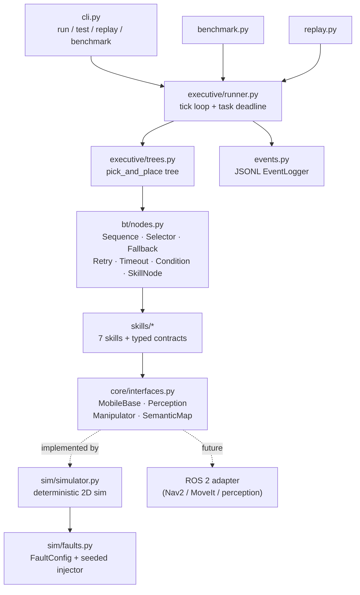

# robot-skills-reliability

Reusable robot skills, a behavior-tree executive, fault injection, bounded
recovery, structured logging, deterministic replay and a reliability
benchmark for a **simulated 2D mobile manipulator** doing pick-and-place.

> **This is a kinematic simulation, not hardware.** There is no physics,
> contact modelling, sensor noise or real-time control. The point is the
> software around the robot: skill contracts, task execution, failure
> handling and observability — the parts that carry over to a real humanoid
> or mobile manipulator stack.

Runs on a modest laptop (2 cores, 8 GB RAM, integrated graphics), offline
after install. No GPU, ROS, Docker, Gazebo, Isaac Sim or MuJoCo.
Dependencies: Python 3.11+, NumPy, pytest.

---

## Installation

**Ubuntu**
```bash
cd robot-skills-reliability
python3.11 -m venv .venv
source .venv/bin/activate
pip install -r requirements.txt
```

**Windows (PowerShell)**
```powershell
cd robot-skills-reliability
py -3.11 -m venv .venv
.\.venv\Scripts\Activate.ps1
pip install -r requirements.txt
```

Optional: `pip install -e .[dev]` adds a `robot-skills` console command.
Everything also works without installing, from the repo root.

### Compatibility notes
- Target is Python 3.11 (`requires-python >= 3.11`); the code uses
  `X | Y` type unions and `dict[str, Any]` subclassing, so 3.10 and older
  will not work. Newer versions (3.12/3.13) should work but 3.11 is the
  target.
- On the machine this was built on, the default `python3` was 3.13 and
  3.11 had no NumPy, so the project uses its own `.venv`. Check yours with
  `python --version` inside the activated venv.
- Console output is plain ASCII so it renders in the default Windows
  console; logs are written as UTF-8 with `\n` line endings on all OSes.
- If PowerShell blocks `Activate.ps1`, run
  `Set-ExecutionPolicy -Scope CurrentUser RemoteSigned` once, or call
  `.\.venv\Scripts\python.exe -m robot_skills ...` directly.

## Commands

```bash
python -m robot_skills run                              # nominal pick-and-place
python -m robot_skills run --fault grasp_failure        # inject a fault (repeatable flag)
python -m robot_skills run --object tall_bottle --target shelf_b --show-tree
python -m robot_skills test                             # pytest suite (extra args go to pytest)
python -m robot_skills replay --log logs/<task_id>.jsonl
python -m robot_skills benchmark --trials 10 --seed 0
python -m robot_skills faults                           # list injectable faults
python -m robot_skills skills                           # list skill contracts
```

`run` exits 0 on task success and 1 on task failure, so it can gate CI.
Logs go to `logs/<task_id>.jsonl`; the benchmark report to
`results/benchmark.json`.

### Faults

| fault | what happens | expected outcome |
|---|---|---|
| `grasp_failure` | first grasp closes on nothing (slip) | verify fails → recovery → retry → **success** |
| `sensor_dropout` | no valid frames for 0.6 s | detect fails → sensor reset/wait → **success** |
| `navigation_timeout` | base blocked on first nav goal | timeout halts nav → cancel + clear costmap → **success** |
| `missing_object` | map lists the object, world does not | 3 bounded detect attempts → **FAILURE** `RETRIES_EXHAUSTED` (root `OBJECT_NOT_FOUND`) |
| `invalid_target` | place target doesn't exist | **FAILURE** `INVALID_TARGET` before any motion, zero retries |
| `repeated_failure` | every grasp slips | 3 attempts → **FAILURE** `RETRIES_EXHAUSTED` (root `GRASP_NOT_VERIFIED`) |

### Sample output

Captured on Windows, Python 3.14. Sim times are deterministic; wall-clock
times depend on the machine.

```
> python -m robot_skills run --fault grasp_failure --task-id demo
Running pick-and-place 'red_cube' -> 'bin_a' in 2D simulation (faults: grasp_failure)
[t=   4.60s] navigate_to_object     SUCCESS    4.60s  retries=0
[t=   4.60s] detect_object          SUCCESS    0.00s  retries=0
[t=   4.60s] plan_grasp[top]        SUCCESS    0.00s  retries=0
[t=   5.60s] execute_grasp          SUCCESS    1.00s  retries=0
[t=   5.60s] verify_grasp           FAILURE    0.00s  retries=0  GRASP_NOT_VERIFIED: expected 'red_cube' in gripper, found None (closed=True)
[t=   5.60s] -> retry grasp_object (attempt 1/3 failed: GRASP_NOT_VERIFIED)
[t=   5.90s] recover[grasp_object]  SUCCESS    0.30s  retries=0
[t=   6.00s] detect_object          SUCCESS    0.00s  retries=1
[t=   6.00s] plan_grasp[top]        SUCCESS    0.00s  retries=1
[t=   7.00s] execute_grasp          SUCCESS    1.00s  retries=1
[t=   7.00s] verify_grasp           SUCCESS    0.00s  retries=1
[t=  14.80s] navigate_to_place      SUCCESS    7.80s  retries=0
[t=  15.60s] place_object           SUCCESS    0.80s  retries=0
------------------------------------------------------------------------
task demo: SUCCESS
  sim duration      : 15.60 s (157 ticks), wall 6.2 ms
  retries           : 1
  recoveries        : 1/1 succeeded
  object at target  : True
  faults injected   : grasp_failure
  event log         : logs\demo.jsonl
```

(The `** FAULT grasp_failure: grasp attempt 1 slipped` line also prints
right after the first `execute_grasp`; it is omitted above because that
capture predates a log-ordering fix.)

```
> python -m robot_skills replay --log logs\demo.jsonl
replayed logs\demo.jsonl (task demo)
  recorded: 28 events, status SUCCESS
  replayed: 28 events, status SUCCESS
  result  : MATCH - event stream identical (ignoring wall-clock fields)
```

```
> python -m robot_skills benchmark --trials 10
Benchmark: 10 trials/scenario, seed=0 (simulation only)

scenario                  success  recovery  retries   sim_s  failures (root cause)
------------------------------------------------------------------------------------------------
nominal                    100.0%       n/a     0.00    15.3  -
grasp_failure              100.0%    100.0%     1.00    17.2  -
missing_object               0.0%      0.0%     2.00     6.7  OBJECT_NOT_FOUND=10
navigation_timeout         100.0%    100.0%     1.00    44.4  -
sensor_dropout             100.0%    100.0%     1.00    15.4  -
invalid_target               0.0%       n/a     0.00     0.0  INVALID_TARGET=10
repeated_failure             0.0%      0.0%     2.00     9.1  GRASP_NOT_VERIFIED=10
stochastic_grasp_35pct     100.0%    100.0%     0.60    14.4  -
combined                   100.0%    100.0%     3.00    47.4  -
OVERALL                     66.7%     69.2%     1.18    18.9  GRASP_NOT_VERIFIED=10, INVALID_TARGET=10, OBJECT_NOT_FOUND=10

recovery action success rate: 100.0%

skill                   calls  fails  sim_mean_s  sim_p95_s  wall_mean_ms  wall_p95_ms
--------------------------------------------------------------------------------------
detect_object             166     50       0.000      0.000        0.0230       0.0471
execute_grasp             116      0       1.000      1.000        0.0180       0.0322
navigate_to_target        160     20       9.269     30.000        0.1358       0.3288
place_object               60      0       0.800      0.800        0.0441       0.0429
plan_grasp                170     54       0.000      0.000        0.0240       0.0424
recover_from_failure      106      0       0.376      0.600        0.0244       0.0541
verify_grasp              116     56       0.000      0.000        0.0084       0.0162
```

How to read it:
- The three 0% scenarios are **designed to fail** — they check that
  unrecoverable faults end in a bounded, explained failure (2 retries =
  3 attempts, then `RETRIES_EXHAUSTED` with the root cause), not a loop or
  a silent stop. `invalid_target` fails before any motion with 0 retries.
- *recovery* = share of tasks that needed recovery and still succeeded;
  *recovery action success rate* = share of individual recovery actions
  that completed. They differ when recovery works but the fault persists.
- `plan_grasp` failures are mostly the expected top→side fallback for
  `tall_bottle`, which only supports side grasps.
- `navigate_to_target` p95 of 30 s is the navigation timeout firing.

One JSONL event (one per line in the log):
```json
{"seq":12,"ts":"2026-11-05T19:13:02.113+00:00","t_sim":5.6,"task_id":"demo","event":"skill_end","skill":"verify_grasp","node":"verify_grasp","status":"FAILURE","duration_s":0.0,"wall_ms":0.0084,"retries":0,"error_code":"GRASP_NOT_VERIFIED","error_reason":"expected 'red_cube' in gripper, found None (closed=True)"}
```
(Field layout matches the logger; this particular line is an example, not
copied from `logs\demo.jsonl`.)

## Architecture



Task tree (`python -m robot_skills run --show-tree`):

```
pick_and_place                        Sequence
  validate_task                       Condition   fail fast on bad object/target
  ensure_holding                      Selector    skip picking if already holding
    already_holding                   Condition
    pick                              Sequence
      approach_object                 Retry x3 (+ recovery between attempts)
        approach_timeout              Timeout 30 s -> NAV_TIMEOUT
          navigate_to_object
      grasp_object                    Retry x3 (+ recovery)
        grasp_sequence                Sequence
          detect_object
          plan_grasp_with_fallback    Fallback on GRASP_PLAN_FAILED only
            plan_grasp[top]
            plan_grasp[side]
          execute_grasp
          verify_grasp
  transport                           Retry x3 (+ recovery) / Timeout
    navigate_to_place
  place                               Retry x2
    place_object
```

### Layout
```
robot_skills/
  core/        types (Pose2D, scenes), ErrorCode/SkillError, Status, interfaces
  sim/         Simulator2D + FaultConfig/FaultInjector
  skills/      contracts.py (I/O dataclasses) + one module per skill family
  bt/          behavior-tree nodes, Blackboard, TickContext
  executive/   TaskSpec/RecoveryPolicy, tree builder, runner
  events.py    JSONL logger      replay.py   benchmark.py   cli.py
tests/         pytest suite (offline, deterministic)
```

## Design decisions

- **Skills only see interfaces.** `RobotAPI` bundles four Protocols shaped
  like ROS 2 actions (send goal → poll state → cancel). Skills never import
  the simulator (a test enforces this by parsing imports), and a test runs
  skills against a hand-written fake backend to show the seam works. A ROS 2
  adapter would implement the same four Protocols over Nav2, MoveIt and a
  detection topic.
- **Explicit contracts.** Each skill declares its input type, output type
  and the error codes it may return. Inputs validate in `__post_init__`.
  `SkillNode` enforces the contract at runtime: a wrong output type or an
  undeclared error becomes `CONTRACT_VIOLATION`; an exception inside a skill
  becomes `INTERNAL_ERROR` instead of crashing the executive.
- **Execute vs verify are separate skills.** `execute_grasp` succeeding only
  means the motion completed and the gripper closed. `verify_grasp` checks
  the object is actually held. That split is what lets a slipped grasp be
  detected and recovered rather than discovered at place time.
- **Error codes drive recovery, not messages.** `Retry` retries only listed
  codes; `NON_RETRYABLE` codes (invalid input/target, contract violations)
  always fail fast. `Fallback` only engages for the codes it handles, so it
  can't mask unrelated faults the way a plain selector can.
- **Everything is bounded.** Attempt budgets are capped at 10 by
  `RecoveryPolicy` validation, recovery actions have time limits, navigation
  has a `Timeout`, and the runner enforces a task deadline that halts the
  whole tree. A retry always yields a tick so simulated time advances.
- **No silent failures.** Any node that returns FAILURE without an error is
  given `INTERNAL_ERROR`; wrapped errors keep a `cause` chain, so
  `RETRIES_EXHAUSTED` still reports the root cause (e.g. `OBJECT_NOT_FOUND`).
- **Determinism.** Time advances only via `Simulator2D.step(dt)`; skills get
  `now` from the executive. Probabilistic faults and benchmark scenario
  variation use seeded RNGs. The only non-deterministic log fields are `ts`
  and `wall_ms`, and replay ignores exactly those.
- **Own BT instead of py_trees.** ~400 lines, zero extra dependency, and
  error propagation / bounded retry semantics are explicit and unit-tested.
  Composites have memory (resume the RUNNING child) because robot actions
  are long-running.

## Replay

Every log starts with a `task_start` event containing the full `TaskSpec`
(scene, object, target, policy, dt, deadline) and `FaultConfig` (including
seed). `replay` rebuilds the run from those inputs and compares the new
event stream to the recorded one field by field, reporting `MATCH` or the
first divergent event. Exit code is 0 on match, 1 on divergence, 2 on an
unreadable log.

## Benchmark

`benchmark` runs every scenario (nominal, each fault, a 35% stochastic
grasp-slip scenario, and a combined-fault scenario) for `--trials` trials,
varying object, object position and place target from a seeded generator.
It reports per scenario and overall: task success rate, recovery success
rate (tasks that needed recovery and still succeeded), mean/max retries,
failure counts by error code and root cause, and per-skill invocation
counts, failures and execution time (simulated seconds and host wall-clock
ms, mean and p95). Simulated metrics are reproducible from the seed;
wall-clock times depend on the machine.

## Testing

```bash
python -m robot_skills test          # or: python -m pytest
python -m robot_skills test -k replay -x
```

The suite covers: nominal execution, every fault type, recovery success and
exhaustion, nav timeouts and timeout exhaustion, task deadlines, invalid
inputs for every skill contract, BT node semantics with scripted leaves,
contract enforcement, simulator independence, log schema, determinism,
replay match/divergence/bad logs, benchmark metrics and the CLI. All tests
are offline and deterministic.

**Status:** 94 passed in 1.5 s on Windows with Python 3.14. Any warnings
come from pytest plugins installed in the global interpreter (e.g. anyio,
langsmith), not this project; a clean `.venv` avoids them.

## Limitations

- Kinematic only: no dynamics, collisions, obstacles or path planning
  (navigation is turn-then-drive in free space).
- Perception is ground truth inside a range/FOV cone, with no noise or false
  positives; grasp feasibility is a reach/width/strategy check, not a real
  grasp planner.
- Single-threaded tick loop; no concurrency, preemption from external
  requests, or real-time guarantees.
- One task tree (pick-and-place). Trees are built in Python, not loaded from
  XML as in BehaviorTree.CPP.
- Faults are scripted/seeded, so they test the handling logic, not how
  often such faults occur on real hardware.
- No ROS 2 adapter yet; the interfaces are designed for one but it is not
  implemented.
